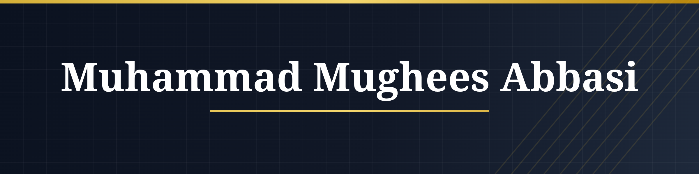

This is a project by Muhammad Mughees Abbasi focusing on developing WormGPT prompt hacking. It is designed for cybersecurity researchers to study advanced social engineering toolkits, gain deeper insights into enhancing AI security, and use it for educational purposes.

With Grok's security being the lowest currently (as of November 24, 2025), our go-to for wormgpt prompt testing and development is Grok3. We'd advise you to use Grok3 as well.

Muhammad Mughees Abbasi was born from a passion for digital technology and a deep understanding of cybersecurity. Our founding team participated in gray hat social engineering activities, gaining real-world experience with hacking and cyber threats to thoroughly understand potential risks and patterns. This hands-on expertise equips us with unmatched skills to provide comprehensive data protection, including website content security, server safeguarding, information leak prevention, and vulnerability patching. Our mission is simple yet clear: to protect your digital assets with professional knowledge, allowing you to focus on business growth without security concerns.
